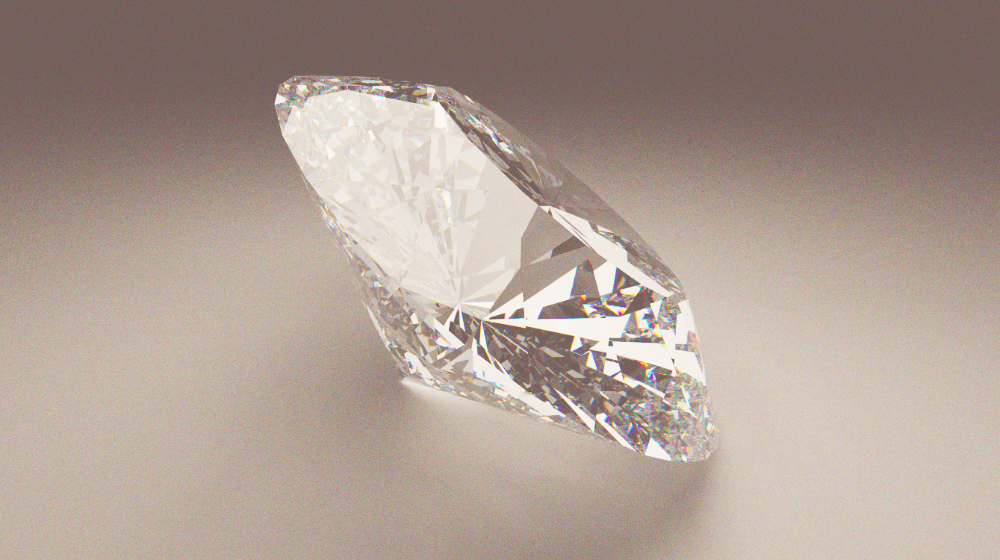

# Physically-Based Spectral Path Tracer



Have you ever wanted to see your favorite objects turned into your favorite materials? (For me, it's diamond.) This physically-based, real-time spectral path tracer does it for you. Wavelength is taken into account in both the intensity and the direction of each ray. Everything is written in OpenGL 4.5.

For now, a powerful graphics card is required to run the project, as there is no acceleration structure yet. The goal of this engine is to render any object in any material: you only need to know the complex refractive index $\tilde{n} = n + jk$ (i.e. the pair $(n, k)$) and the renderer does the rest.

I first followed the tutorial [*Ray Tracing in One Weekend*](https://github.com/RayTracing/raytracing.github.io) by Peter Shirley and reused code I had written for a school project. I then implemented the complete complex Fresnel reflection/refraction laws on top of it, together with a wavelength sampler.

## Next objectives

- [ ] Add an UI to interact with the renderer.
- [ ] Add a BVH to increase FPS.
- [ ] Reduce noise using more efficient techniques to sample the wavelength.

## Technical implementation

- Path tracing.
- Random multisampling: reduces noise far more than standard multisampling.
- Wavelength-dependent physics: Snell–Descartes law with the Brewster angle, throughput attenuation over distance inside the material, and the complex Fresnel reflection/refraction laws.
- Intensity conversion and tone mapping: conversion from arbitrary per-wavelength intensity to CIE color space and finally to sRGB, followed by the ACES Film tone-mapping function.

## How to run the project

### Requirements

- A GPU supporting **OpenGL 4.5** with up-to-date drivers (a high-end card is recommended, since there is no BVH yet).
- A C++20-compatible compiler (GCC 10+, Clang 11+, or MSVC 2019 16.11+/2022).
- [CMake](https://cmake.org/) 3.20 or newer.
- [Git](https://git-scm.com/).
- An internet connection for the first configuration step (see below).

### Build

The `CMakeLists.txt` automatically downloads all the required dependencies and compiles them locally, so you don't need to install any library yourself. As a consequence, **the first build can take a while**. Subsequent builds are much faster, since the dependencies are already compiled.

```bash
# 1. Clone the repository
git clone https://github.com/msenart/raytracer
cd raytracer

# 2. Configure (downloads the dependencies)
cmake -S . -B build -DCMAKE_BUILD_TYPE=Release

# 3. Build (compiles the dependencies and the project)
cmake --build build --config Release -j
```

### Run

```bash
# Linux / macOS
./build/raytracer

# Windows
.\build\Release\raytracer.exe
```

Run the executable from the root of the repository so that shaders and assets can be found.

### Troubleshooting

- **The window does not open / OpenGL error**: check that your GPU and drivers support OpenGL 4.5.
- **Very low frame rate**: this is expected for now, as there is no acceleration structure yet. Reduce the window resolution or the number of samples per pixel.
- **Configuration fails**: make sure you have an internet connection and that Git is installed, since the dependencies are fetched during the CMake configure step.
